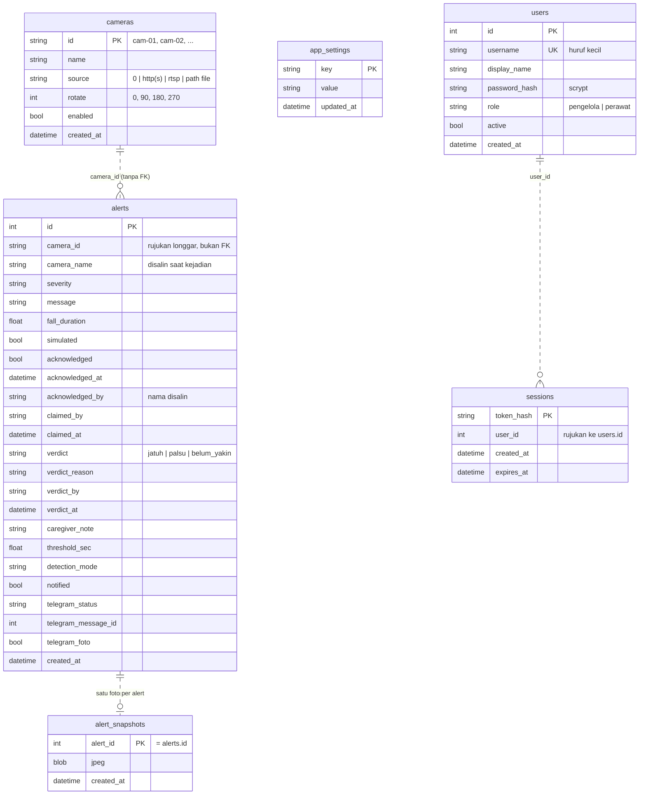

# SCHEMA.md

Skema database FallDetect, ditulis dari kode di `backend/app/db/models.py` dan `backend/app/db/database.py`. Kalau kode dan dokumen ini berbeda, yang benar adalah kode. Perbaiki dokumen ini dalam perubahan yang sama.

## Mesin dan lokasi

- **SQLite**, satu berkas `backend/fall_detection.db`. Lokasinya diatur `DATABASE_URL` di `backend/app/core/config.py`, dengan bawaan `sqlite+aiosqlite:///./fall_detection.db`. Berkas ini tidak ikut Git.
- Diakses lewat **SQLAlchemy async + aiosqlite**, supaya kerja database tidak memblokir video dan WebSocket.
- Satu backend memegang satu database. Saat pameran, hanya satu laptop yang menjalankan backend, jadi semua dashboard membaca data yang sama.

## Tabel

Semua garisnya putus-putus, karena database ini tidak memasang foreign key sama sekali (`models.py` tidak memakai `ForeignKey`). Hubungan antartabel dijaga oleh kode.

### `cameras`

Daftar kamera. Disimpan di database supaya alamat kamera HP bisa diganti dari dashboard tanpa menyunting kode atau me-restart server.

- `id` dibentuk `cam-NN`. Nomornya tidak pernah dipakai ulang, walaupun kameranya sudah dihapus (lihat `camera_last_number`).
- `source` hanya berlaku di laptop yang menjalankan backend. Contohnya, `0` adalah webcam laptop itu.

### `app_settings`

Pengaturan dari dashboard yang harus bertahan setelah restart. Bentuknya pasangan kunci-nilai, supaya menambah pengaturan baru tidak butuh `ALTER TABLE`.

| Kunci | Isi | Ditulis oleh |
|---|---|---|
| `detection_mode` | Model aktif (`bbox` atau `pose`) | `api/settings.py` |
| `fall_duration_threshold` | Ambang detik sebelum alarm | `api/settings.py` |
| `camera_last_number` | Nomor kamera tertinggi yang pernah dipakai | `db/repository.py` |
| `telegram_photo_mode` | Cara foto dikirim ke Telegram (`buram` bawaan, `utuh`, ...) | `db/repository.py` |
| `telegram_send_drills` | `1` bila latihan ikut dikirim ke Telegram | `db/repository.py` |
| `telegram_camera_offline` | `1` bila kamera terputus dikabarkan ke Telegram (bawaan `1`) | `db/repository.py` |

Rahasia seperti token bot dan ID chat Telegram tidak disimpan di sini. Keduanya tetap di `backend/.env`.

### `alerts`

Riwayat insiden. Satu baris untuk satu alarm yang dikonfirmasi state machine.

- **Kejadian:** `camera_id`, `camera_name`, `message`, `severity`, `fall_duration`, `created_at`. Nilai `simulated` = latihan, bukan kejadian sungguhan.
- **Penanganan:** `claimed_by`/`claimed_at` diisi saat ada yang menekan "Saya ke sana". `acknowledged`, `acknowledged_by`, dan `acknowledged_at` diisi saat alarm ditandai ditangani. `caregiver_note` berisi catatan perawat.
- **Putusan:** `verdict` bernilai `jatuh`, `palsu`, atau `belum_yakin`, dan NULL berarti belum dinilai. Untuk alarm palsu, `verdict_reason` berisi kode alasannya. Putusan sengaja dipisah dari penanganan, karena alarm bisa sudah ditangani tetapi belum dinilai.
- **Keadaan sistem saat kejadian:** `threshold_sec` dan `detection_mode`. Tanpa keduanya, angka alarm palsu tidak bisa ditafsirkan.
- **Telegram:** `telegram_status` bernilai `mengirim`, `terkirim`, `gagal`, `mati`, atau `dilewati`. `telegram_message_id` dipakai untuk menyunting pesan yang sama, dan `telegram_foto` menandai pesan berupa foto. Pada alert lama, `telegram_status` NULL dan yang berlaku adalah `notified`.
- Nama ruang (`camera_name`) dan nama orang (`*_by`) **disalin, bukan dirujuk**. Riwayat harus tetap menyebut tempat dan orangnya walaupun kameranya dihapus atau akunnya dinonaktifkan. Pada alert lama, `camera_name` bisa NULL, dan `camera_id` dipakai sebagai cadangan.

### `alert_snapshots`

Foto kejadian, satu per alert, dengan `alert_id` sama dengan `alerts.id`. Dipisah dari `alerts` supaya daftar riwayat tidak ikut memuat gambar. Foto hanya bisa dibuka lewat API yang wajib login.

### `users`

Akun per orang, karena tombol "Saya ke sana" harus menyebut siapa yang menuju lokasi.

- `role`: `pengelola` atau `perawat`. Yang khusus pengelola saat ini hanya pengelolaan akun (`/api/users`). Kamera dan pengaturan masih bisa diubah oleh akun mana pun yang login. Sistem harus selalu punya minimal satu pengelola aktif.
- `password_hash` disimpan dalam format `scrypt$n$r$p$garam$turunan`, dengan garam acak per akun (`core/keamanan.py`).
- Akun tidak dihapus, hanya dinonaktifkan (`active = false`), supaya nama di riwayat tetap bermakna.
- Akun tim berupa satu akun demo, dibuat atau disamakan setiap backend menyala dari `DEMO_USERNAME` dan `DEMO_PASSWORD` di `backend/.env`, dengan peran `pengelola` (`siapkan_akun_demo` di `api/auth.py`). Tidak ada akun atau kata sandi yang ditulis di kode, dan tidak ada formulir pembuat akun pertama.

### `sessions`

Sesi masuk. Yang disimpan hanya hash token, sedangkan tokennya sendiri ada di cookie HttpOnly. Sesi berlaku 30 hari (`UMUR_SESI` di `api/auth.py`), dan sesi kedaluwarsa dibersihkan saat ada yang masuk.

## Batasan dan akses

- Semua API, video, dan WebSocket wajib login (`wajib_login`, dipasang di `backend/app/main.py`). Kecualinya `/api/auth` (status, masuk, pengunjung, keluar) dan health check. Hanya `/api/users` yang khusus `pengelola` (`wajib_pengelola` di `api/auth.py`). Pembatasan ini dijaga di backend, bukan di database: SQLite tidak punya row-level security.
- `users.username` unik dan disimpan dalam huruf kecil.
- Pengunjung pameran (dari QR di stand) tidak punya baris di tabel mana pun. Cookie lihat-sajanya ditandatangani HMAC dengan `VISITOR_TOKEN` dan berlaku 12 jam; token baru dari launcher membatalkan cookie lama. Pengunjung boleh semua GET kecuali `/api/users`, dan metode lain ditolak 403 (`tolak_perubahan_pengunjung` di `api/auth.py`).
- Nilai seperti `role`, `verdict`, dan `telegram_status` disimpan sebagai teks bebas di database. Validasinya ada di skema Pydantic (`backend/app/models/schemas.py`).

## Cara skema diperbarui

Proyek ini tidak memakai alat migrasi seperti Alembic.

1. Saat backend menyala, `init_db()` di `database.py` menjalankan `create_all`, yang membuat tabel yang belum ada.
2. `create_all` tidak menambah kolom ke tabel yang sudah ada. Karena itu, setiap kolom baru juga didaftarkan di `_KOLOM_SUSULAN`, dan `_tambal_kolom` menambahkannya dengan `ALTER TABLE` ke database lama tanpa menghapus riwayat.
3. Untuk perubahan yang lebih berat, seperti mengganti nama atau tipe kolom, pakai Alembic. Mekanisme di atas tidak cukup untuk itu.

Menambah kolom berarti mengubah tiga tempat dalam satu commit: `models.py`, `_KOLOM_SUSULAN`, dan dokumen ini.
