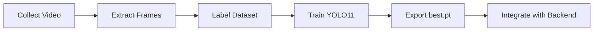
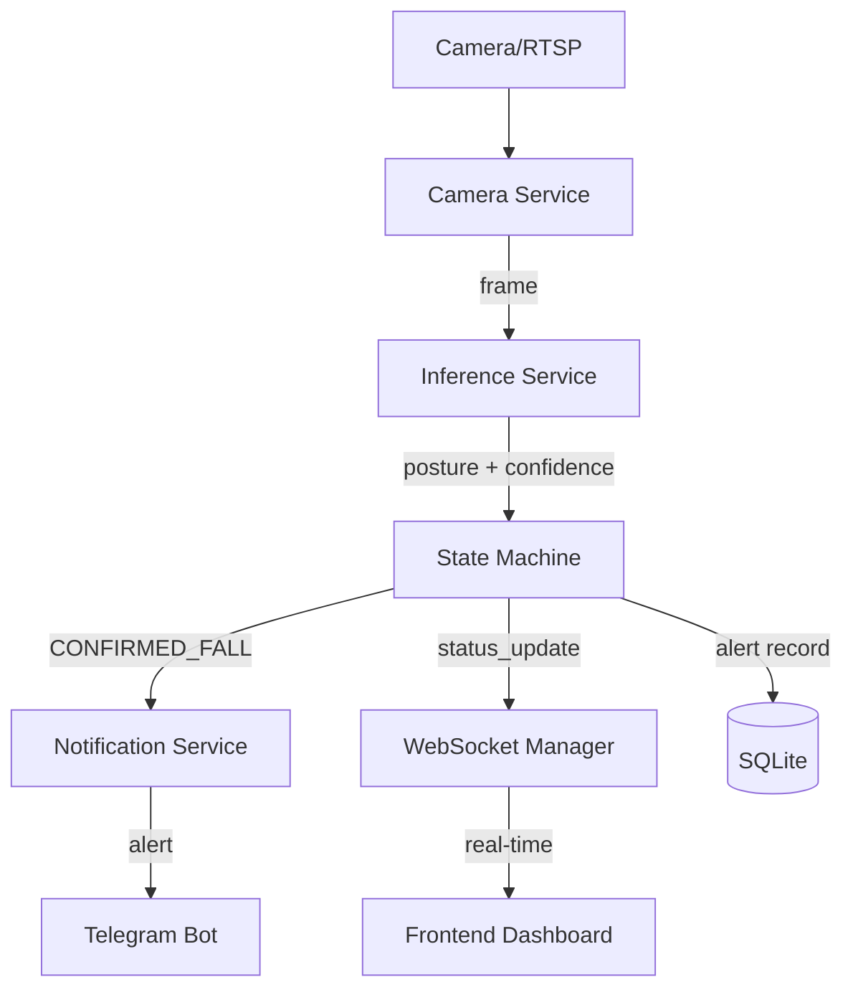
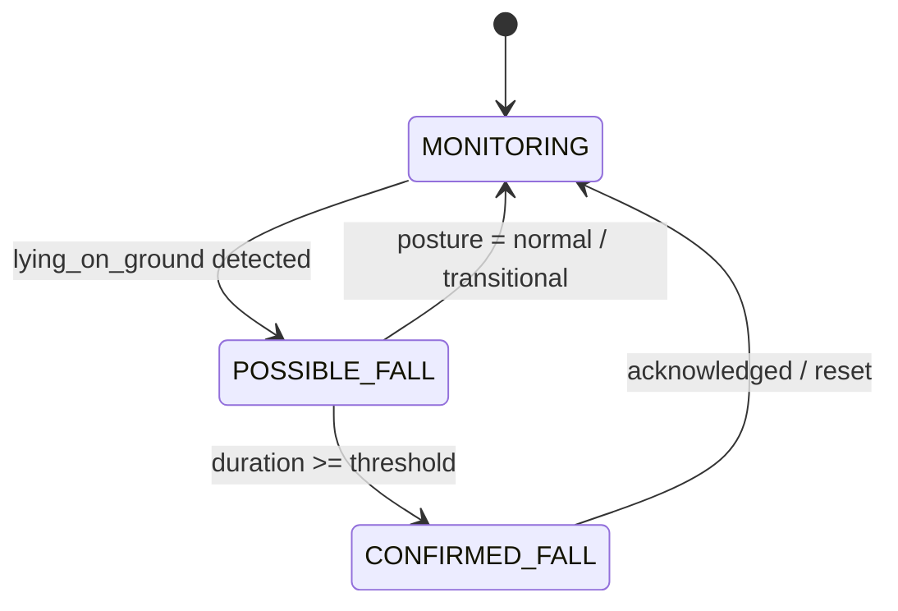

# Architecture Overview

Dokumentasi arsitektur sistem Fall Detection untuk panti jompo.

## System Overview

```
┌─────────────┐     ┌──────────────────────────────────────────────────────┐
│  IP Camera  │     │                    BACKEND (FastAPI)                  │
│  / Webcam   │────▶│                                                      │
│  (RTSP)     │     │  ┌────────────┐  ┌──────────────┐  ┌─────────────┐  │
└─────────────┘     │  │  Camera    │  │  Inference   │  │   State     │  │
                    │  │  Service   │──│  Service     │──│   Machine   │  │
                    │  │ (capture)  │  │ (YOLO11 .pt) │  │  (per cam)  │  │
                    │  └────────────┘  └──────────────┘  └──────┬──────┘  │
                    │                                           │         │
                    │                    ┌──────────────────────┤         │
                    │                    ▼                      ▼         │
                    │  ┌─────────────────────┐  ┌────────────────────┐   │
                    │  │  Notification       │  │   WebSocket        │   │
                    │  │  Service (Telegram) │  │   Manager          │   │
                    │  └─────────────────────┘  └────────┬───────────┘   │
                    │                                    │               │
                    │  ┌─────────────────────┐           │               │
                    │  │  SQLite Database    │           │               │
                    │  │  (alert history)    │           │               │
                    │  └─────────────────────┘           │               │
                    │                                    │               │
                    │  ┌─────────────────────┐           │               │
                    │  │  REST API           │           │               │
                    │  │  /api/alerts        │           │               │
                    │  │  /api/cameras       │           │               │
                    │  │  /api/settings      │           │               │
                    │  └─────────┬───────────┘           │               │
                    └────────────┼────────────────────────┼───────────────┘
                                 │                        │
                    ┌────────────┼────────────────────────┼───────────────┐
                    │            ▼          FRONTEND      ▼               │
                    │  ┌─────────────────┐  ┌────────────────────┐       │
                    │  │  API Client     │  │  WebSocket Client  │       │
                    │  │  (axios)        │  │  (auto-reconnect)  │       │
                    │  └────────┬────────┘  └────────┬───────────┘       │
                    │           │                     │                   │
                    │  ┌────────┴─────────────────────┴───────────┐      │
                    │  │              React Dashboard              │      │
                    │  │  ┌───────────┐ ┌──────────┐ ┌─────────┐ │      │
                    │  │  │ Dashboard │ │  Alert   │ │Settings │ │      │
                    │  │  │ (live)    │ │ History  │ │(thresh) │ │      │
                    │  │  └───────────┘ └──────────┘ └─────────┘ │      │
                    │  └──────────────────────────────────────────┘      │
                    └───────────────────────────────────────────────────┘
```

## Development Phase



1. **Data Collection**: Download UR Fall Detection Dataset.
2. **Frame Extraction**: `ml/scripts/extract_frames.py` → frame individual.
3. **Dedup**: `ml/scripts/dedup_check.py` → hapus frame redundan.
4. **Label Conversion**: Convert UR Fall labels (-1/0/1) ke YOLO format (0/1/2).
5. **Training**: `ml/training/train.py` dengan config di `config.yaml`.
6. **Export**: Model `best.pt` tersimpan di `ml/models/`.

## Real-Time Deployment Phase



## State Machine Diagram



## Tech Stack

| Layer     | Technology             |
|-----------|------------------------|
| ML        | YOLO11 (ultralytics)   |
| Backend   | FastAPI + uvicorn      |
| Database  | SQLite (aiosqlite)     |
| Frontend  | React + Vite           |
| Notif     | Telegram Bot API       |
| Deploy    | Docker Compose         |

## Filosofi alarm dan tabel status

Acuan bersama tim untuk semua layar dan pesan yang berkaitan dengan alarm. Alasannya
berasal dari riset referensi UI/UX proyek ini (audit 41 temuan, rencana Tahap 1 dan 2).

### Prinsip

1. **Alarm berarti kemungkinan, bukan kepastian.** Model membaca postur berbaring,
   bukan kejadian jatuh. Kata yang dipakai: "Kemungkinan jatuh" dan "terbaca
   berbaring N detik", tidak pernah "Terdeteksi jatuh" atau "tidak bergerak".
2. **Tidak ada rasa aman palsu.** Kamera yang tidak menemukan orang tidak disebut
   Normal, dan kamera yang buta selalu terlihat sebagai Terputus, di layar dan di grup.
3. **Satu warna, satu arti.** Merah hanya untuk alarm yang belum direspons. Amber untuk
   hitungan berbaring dan untuk alarm yang sudah ada yang menuju lokasi. Biru untuk
   latihan dan info. Abu-abu untuk hal teknis dan keterangan. Hijau hanya untuk logo,
   tombol utama, dan tanda selesai. Setiap status juga punya ikon dan kata, tidak
   mengandalkan warna saja.
4. **Penanganan dua langkah, terlihat semua orang.** "Saya ke sana" mencatat nama,
   menghentikan bunyi di semua dashboard, dan menyunting pesan Telegram. "Tandai
   Ditangani" dilakukan setelah penghuni ditolong.
5. **Penanganan dan putusan dipisah.** Putusan (jatuh sungguhan, alarm palsu dengan
   alasan, belum yakin) menjawab seberapa sering alarmnya salah. Alarm tanpa putusan
   tetap di antrean Perlu tindakan.
6. **Tidak ada yang menutup alarm diam-diam.** Tidak ada penutupan otomatis, penutupan
   massal, atau bisu tanpa jejak. Bisu hanya 5 menit dan hanya untuk alarm yang sedang
   tampil; alarm baru tetap berbunyi.
7. **Privasi lebih dulu.** Foto di Telegram bawaannya diburamkan dan semua pesan
   dilindungi dari penerusan. Foto lengkap hanya bisa dibuka setelah masuk. Tidak ada
   pengenalan wajah.
8. **Latihan tidak boleh tertukar dengan kejadian nyata.** Latihan berwarna biru, bernada
   lain, tidak dinilai, tidak ikut dihitung, dan secara bawaan tidak dikirim ke Telegram.

### Status kamera (tile di Pemantauan)

| Status | Bentuk | Arti | Yang perlu dilakukan |
|---|---|---|---|
| Terpantau | lingkaran, abu-abu | model melihat orang dan posturnya bukan berbaring | tidak ada |
| AI tidak menemukan orang | mata tercoret, abu-abu | ruang kosong, atau model gagal membaca orangnya | lihat videonya bila seharusnya ada orang; jam orang terakhir terlihat ditampilkan |
| Berbaring 00:02 dari 00:03 | belah ketupat, amber | hitungan berjalan, alarm belum berbunyi | pantau |
| Kemungkinan jatuh | segitiga, merah | ambang terlewati, alarm berbunyi; tile naik ke depan | tangani lewat banner |
| Latihan | labu kimia, biru | Mode latihan berjalan | ikuti alur seperti alarm sungguhan |
| Terputus | kamera tercoret, garis putus-putus | kamera tidak mengirim gambar; jatuh di ruang ini tidak terdeteksi | periksa daya, jaringan, dan alamat di Daftar Kamera |

### Status insiden (banner dan Riwayat Insiden)

| Status | Warna banner | Bunyi | Siapa yang mengubah |
|---|---|---|---|
| Belum direspons | merah | berulang tiap 4 detik | muncul saat ambang terlewati |
| Menuju lokasi | amber, dengan nama penangan | berhenti di semua dashboard | "Saya ke sana" di dashboard atau Telegram |
| Ditangani | banner hilang | tidak | "Tandai Ditangani", atau tombol putusan di Telegram |
| Putusan: jatuh sungguhan, alarm palsu (alasan wajib), belum yakin | | | saat menutup, atau belakangan di Riwayat Insiden |
| Belum dinilai | | | ditutup tanpa putusan; tetap di antrean Perlu tindakan |

### Aturan angka

Waktu respons dihitung juga untuk alarm palsu, karena perawat tidak tahu statusnya
sebelum memeriksa. Latihan keluar dari semua angka. Persentase selalu disertai jumlah
absolut, misalnya "3 dari 12". Recall tidak bisa dihitung dari putusan, karena jatuh
yang terlewat tidak pernah muncul di daftar.
